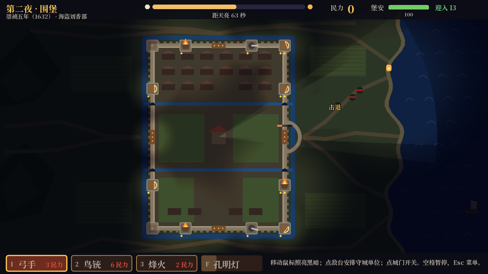

# 永昌守望 · Yongchang Watch

2026 开源游戏开发大赛参赛作品，主题「守·望」。制作：队伍“什么都不会”（ChrisTu117）。

明代温州永嘉场，乡人为抵御倭寇筑起永昌堡。你是敌台上的守望人：夜里海面一片漆黑，**你望向哪里，光就照到哪里**；守城单位只打得中被照亮的敌人。守住城门，也要望一望城外——开门迎进投奔的乡亲。每守住一夜，就用龙湾宁村的拼字龙灯按笔顺描出一个字，三夜加终章，拼成“天下太平”。



## 玩法

- **望**：移动鼠标，望楼的光束跟着转。敌人和船在黑暗里看不清，守城单位只打得中被照亮的敌人〔C10〕。按 F 放孔明灯，能照亮远处一大片。
- **守**：点城墙上的敌台，安排弓手、鸟铳或烽火（烽火不攻击，长久照亮周围）；再点一次升级。点城门开门或关门；城门被攻破后，点它花民力修好。东门有瓮城，更耐砸。
- **守望相助**：乡亲走到门前会喊“开门”，开门迎进来，每人给 2 点民力；堡内农田屯田，每 12 秒 1 点民力。敌人靠近时要记得关门。
- **三夜**：嘉靖三十八年（1559）筑堡、崇祯五年（1632）刘香围堡、顺治五年（1648）何兆龙来犯、避乱者万人。史实条目都标了出处〔C11〕，地图的四座城门、四座水门、十二座敌台和东门瓮城与资料一致〔C16〕。
- **舞龙显字**：每夜守住后，用拼字龙灯（龙头、七节龙身、龙尾共九节）按笔顺描出“天”“下”“太”“平”，笔顺与汉典一致〔C12〕。
- 第一夜有分步教学：望向海面、安排弓手、开门迎人、关门御敌〔C9〕。会玩能守住三夜，什么都不做必然失守〔C10〕。

## 运行

| 平台 | 方法 |
|---|---|
| Windows 10/11（64 位） | 下载 `YongchangWatch-<版本>-win64.zip`，解压后双击 `YongchangWatch.exe`，不用安装〔C7〕〔M1〕 |
| 装了 LÖVE 11.5 的电脑 | 在仓库目录运行 `love .`，或运行 `YongchangWatch-<版本>.love`〔C5〕 |
| Dora SSR 1.10（Dora 平台兼容版本） | 运行仓库根目录的 `init.lua`：先打开 Dora，再执行 `Dora --asset <Dora 资源目录> cli run -p <仓库目录>`（或解压 `YongchangWatch-<版本>-dora.zip` 后对解压出的目录执行同一命令）。`<Dora 资源目录>` 是含 `Script/Dev/cli.lua` 的目录，Windows 版就是 `Dora.exe` 所在的文件夹。`init.lua` 用 `LoveNode("main.lua")` 加载同一份 LÖVE 项目，并用 2D 摄像机等比适配屏幕。Windows 和 macOS 版 Dora 启动后显示内置 IDE，IDE 盖着时游戏不绘制，`init.lua` 启动时会把 IDE 收起〔C6〕；如果仍然只看到 IDE，在 Dora 窗口里按 Ctrl+Shift+H 切到游戏画面。已在 Dora SSR 1.10.2 Linux 版上自动实测〔C18〕，Windows 版也已在真机上玩过（2026-11-27）〔M2〕 |

操作：鼠标照亮与点击；`1` `2` `3` 切换弓手、鸟铳、烽火；`F` 孔明灯；空格暂停；`Esc` 菜单（可返回标题或退出游戏）〔C8〕；`M` 静音。

## Dora 平台兼容说明

- 入口：根目录 `init.lua`（只用 Dora 接口）→ `LoveNode("main.lua")` → 根目录 `main.lua`、`conf.lua`、`src/`（只用 `love.*` 接口）。依赖：无，字体和音效都在 `assets/` 里。
- 实机检查：`tools/check_dora_runtime.sh` 在 Dora SSR 1.10.2 Linux 版里运行 `init.lua`，用真实的鼠标键盘事件从标题点进第一夜、走完三步教学、用菜单返回和退出，并核对 Dora 日志没有报错〔C18〕。
- Dora 的 LoveNode 把鼠标点击作为触摸回调送给游戏，游戏同时接鼠标和触摸回调，同一次点击只处理一次（`src/input.lua`，端到端测试覆盖）〔C5〕。在 Dora 里运行时底部有一条开发工具栏，`init.lua` 把游戏画面放在它上方。
- Windows 和 macOS 版 Dora 启动后显示内置 Web IDE；IDE 盖着窗口时，引擎照常运行逻辑和声音，但不绘制画面（Dora 1.10.2 源码 `Director::doRender`）。从 IDE 的运行按钮启动时 IDE 会自己收起，用命令行 `cli run` 启动时不会，于是只有声音没有画面。`init.lua` 照 Dora 自带脚本的做法发出 `AppWebView /ide/hide` 收起 IDE；在 Windows 上按 Ctrl+Shift+H 可以在 IDE 和游戏之间切换〔C6〕。
- Dora 的 LoveNode 用 Lua 5.5 运行 LÖVE 代码。游戏代码不用 LuaJIT 专有功能、不用物理和自定义着色器，单元测试在 LuaJIT 和 Lua 5.5 下都通过〔C6〕。
- 字体转成了 TrueType 轮廓，覆盖游戏里的全部文字〔C3〕。

## 授权

- 代码：AGPL-3.0（`LICENSE`），每个代码文件开头有 SPDX 标注〔C1〕。
- 团队原创的音效和音乐：CC BY 4.0（`LICENSE-ASSETS`，https://creativecommons.org/licenses/by/4.0/ ），由 `tools/gen_audio.py` 合成，可逐字节重现〔C2〕。
- 第三方：只有字体 Noto Serif CJK SC 的子集，SIL OFL 1.1（`assets/fonts/OFL.txt`）〔C3〕〔C4〕。完整清单见 `ASSETS.md`。

## 自动检查

```bash
bash tools/check_all.sh
```

依次运行：LuaJIT 和 Lua 5.5 单元测试、Dora 兼容静态检查、字体覆盖检查、LÖVE 11.5 端到端试玩（虚拟显示器里用模拟的鼠标键盘从标题玩到终章再从菜单退出，并截图）、打包与包结构检查，最后核对本 README、提交表草稿、开发者日志和 AI 声明里每个〔C〕〔M〕编号对应的检查。〔M〕是需要在真机上确认的项目，记录在 `docs/人工检查记录.md`。

## 文档

- `docs/AI使用与素材声明.md`：AI 工具、用途、生成内容、人工修改，赛前已有的代码、工具与素材〔C14〕
- `docs/中文说明.md`：代码结构与关键实现的中文讲解
- `docs/devlog/`：开发者日志〔C13〕。`tools/export_devlogs.py` 生成发到社交媒体用的版本（去掉〔〕编号，正文不改）
- `docs/文化资料与出处.md`：史实出处
- `docs/B站发布稿.md`：演示视频的 B 站标题、简介和标签。视频由 `tools/record_demo.sh` 录制（画面逐帧截自游戏，声音是游戏自带的音效和音乐），`tools/check_demo_video.py` 验收时长、声音和三夜是否守住〔M3〕
- `ASSETS.md`：素材清单与授权

开发从 2026-11-21 主题公布后开始，提交历史见 git log〔C15〕。
